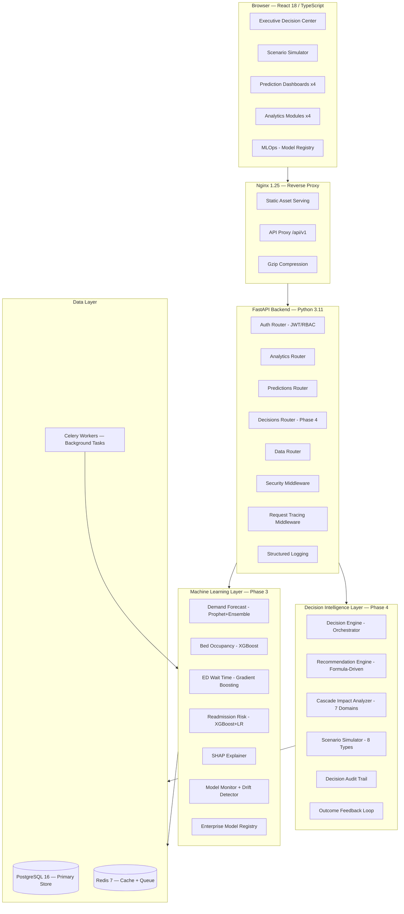
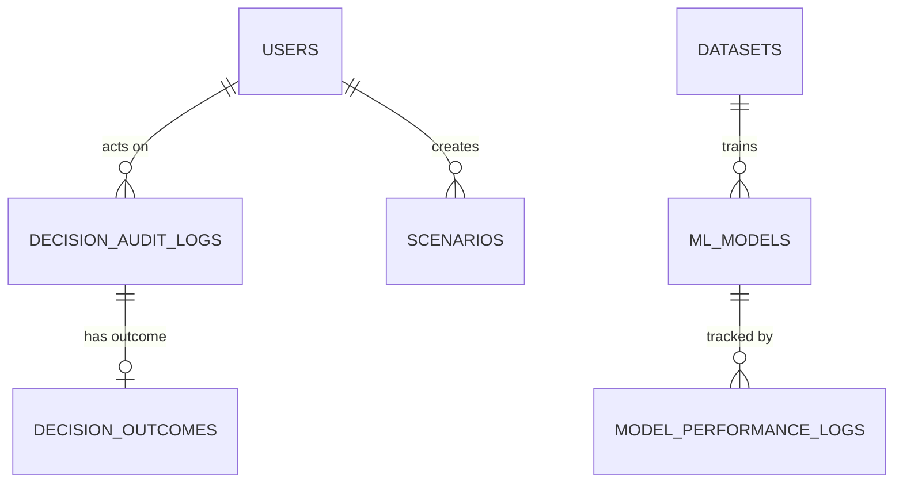

# HDIP Architecture Documentation

## System Architecture

HDIP is a layered, full-stack enterprise platform built on a clean separation of concerns across five architectural layers: **Presentation**, **API Gateway**, **Business Logic**, **Machine Learning**, and **Data**.

---

## Architecture Diagram



---

## Data Flow

### Prediction Pipeline
```
User Input → FastAPI Validation → ML Model.predict() 
→ SHAP Explainer.explain() 
→ Impact Assessment (_assess_impact) 
→ RecommendationEngine.generate() 
→ compute_confidence_profile() 
→ JSON Response
```

### Scenario Simulation Pipeline
```
Scenario Params → ScenarioSimulator._build_baseline()
→ _apply_perturbations() 
→ _run_perturbed_models() (all 4 models re-executed)
→ CascadeAnalyzer.analyze() (7 domains)
→ RecommendationEngine.generate() (scenario recs)
→ compute_confidence_profile() (with penalties)
→ Full SimulationResult JSON
```

### Decision Audit Lifecycle
```
Recommendation Generated 
→ Executive Reviews (confidence profile + reasoning chain)
→ Accept / Reject / Defer → DecisionAuditLog created
→ "Mark Implemented" → status = "implemented"
→ "Record Outcome" → DecisionOutcome created
→ Effectiveness Scores computed (3 dimensions)
→ Aggregate quality metrics updated
```

---

## Database Schema

### Core Tables

| Table | Purpose | Key Columns |
|---|---|---|
| `users` | User accounts & roles | id, email, role, hashed_password |
| `datasets` | Uploaded hospital datasets | id, filename, row_count, status, profiler_result |
| `ml_models` | ML Model Registry entries | id, model_type, version, metrics, is_active |
| `model_performance_logs` | Drift & performance tracking | model_type, mse, mae, drift_score |
| `operational_alerts` | Proactive risk alerts | severity, title, is_acknowledged, status |
| `scenarios` | Saved what-if simulations | scenario_type, perturbations, simulation_confidence |
| `decision_audit_logs` | Decision governance trail | action, priority_tier, confidence_profile, reasoning_chain |
| `decision_outcomes` | Actual vs predicted feedback | expected_*, actual_*, effectiveness scores |

### Entity Relationships



---

## Module Structure

### `app/core/`
| File | Responsibility |
|---|---|
| `database.py` | SQLAlchemy async engine, session factory |
| `permissions.py` | JWT validation, `get_current_user` dependency |
| `rbac.py` | Role hierarchy, `require_roles()` dependency factory |
| `middleware.py` | SecurityHeadersMiddleware, RequestTracingMiddleware |
| `logging.py` | structlog configuration (JSON prod / console dev) |
| `indexes.py` | Performance index definitions for high-traffic queries |

### `app/modules/decisions/`
| File | Responsibility |
|---|---|
| `engine.py` | DecisionEngine — coordinates Predict→Explain→Impact→Recommend |
| `recommendation_engine.py` | Quantitative formula-driven recommendations, confidence profiles |
| `cascade_analyzer.py` | 7-domain downstream operational impact analysis |
| `scenario_simulator.py` | 8-type what-if simulation with model re-execution |
| `router.py` | 11 REST endpoints for all Decision Intelligence operations |

---

## Security Architecture

```
Request → Nginx → FastAPI
                    ↓
           RequestTracingMiddleware (X-Request-ID injection)
                    ↓
           SecurityHeadersMiddleware (HSTS, CSP, X-Frame-Options)
                    ↓
           CORSMiddleware (origin allowlist)
                    ↓
           Route Handler
                    ↓
           get_current_user() → JWT validation → User lookup
                    ↓
           require_roles() → role hierarchy check
                    ↓
           Business Logic
```

---

## Performance Optimizations

- **Async everywhere**: FastAPI + asyncpg + SQLAlchemy async = non-blocking I/O throughout
- **Connection pooling**: PostgreSQL connection pool (min 5, max 20)
- **Targeted indexing**: Composite indexes on `audit_log (action, model_type)`, `alerts (acknowledged, severity)`, `scenarios (type, created_at)`, `ml_models (type, active)`
- **Redis caching**: Celery result backend, task state persistence
- **Docker multi-stage builds**: Build toolchains stripped from runtime image (~300MB → ~150MB)
- **Nginx gzip compression**: Static assets and API responses compressed
- **Frontend code splitting**: Vite lazy-loads route components
